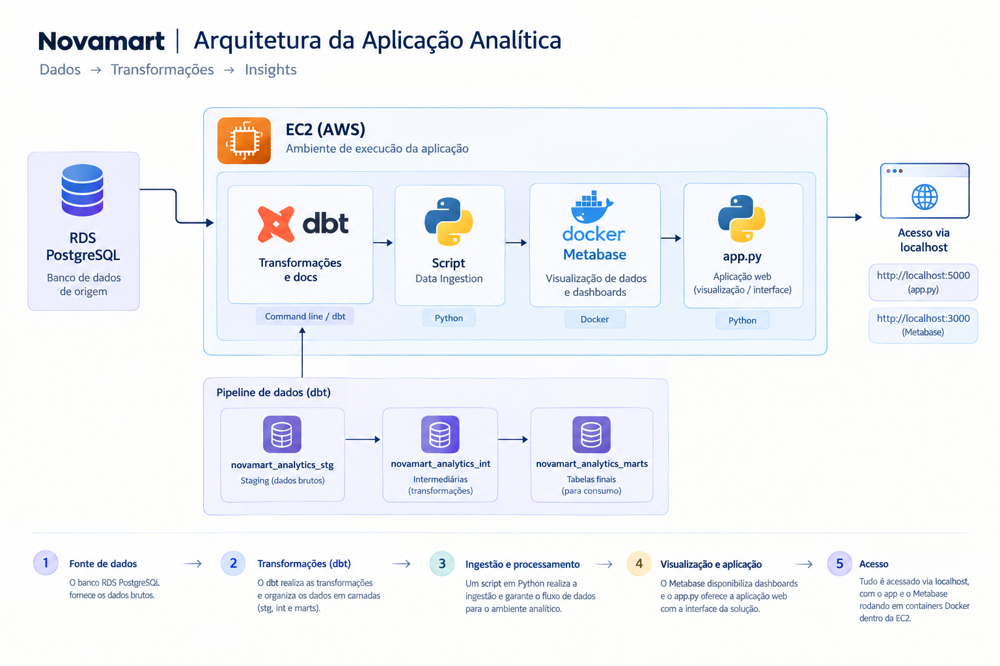

# NovaMart

Marketplace fictício para praticar desenvolvimento web e engenharia analítica de ponta a ponta: aplicação Flask, PostgreSQL, ingestão simulada, transformações dbt, testes de qualidade e dashboards no Metabase.

> Projeto educacional com dados sintéticos. Não foi preparado para uso em produção.

## Arquitetura



```text
Usuário → Flask → PostgreSQL (app)
                     ↓
Cron → ingestão → dbt (stg → int → marts) → Metabase
                       └→ testes, logs e alerta opcional no Discord
```

## O que o projeto faz

- Aplicação web para consultar e cadastrar clientes, vendedores, produtos e pedidos; exibe indicadores e pedidos recentes e gera relatórios mensais em PDF.
- Banco PostgreSQL com entidades de marketplace e dados fictícios gerados para exploração.
- Pipeline de analytics dbt:
  - **stg:** views para padronizar os dados da origem;
  - **int:** modelos incrementais de pedidos, itens e pagamentos enriquecidos;
  - **marts:** fato de itens de pedido e relatório de Pareto de produtos.
- Simulador de ingestão contínua e orquestrador para executar ingestão, builds dbt, documentação e alertas.
- Rota `/dashboard` preparada para incorporar um dashboard assinado do Metabase.

## Ferramentas e práticas exploradas

Python, Flask, Jinja2, PostgreSQL, SQL, psycopg2, dbt Core, `dbt-postgres`, Metabase, cron, Discord Webhooks, testes automatizados, modelos incrementais, análise exploratória e geração de PDF.

## Qualidade de dados

Os testes dbt ajudam a detectar dados inválidos antes do consumo analítico:

- `not_null` para identificadores e campos essenciais de pedidos;
- `accepted_values` para status de pedidos e pagamentos;
- `relationships` para validar se o cliente que indicou outro cliente existe;
- teste singular `assert_order_item_price_matches_quantity`, que compara preço total com quantidade × preço unitário;
- flags analíticas para sinalizar margem negativa e datas ausentes.

`scripts/inject_bad_data.py` insere casos inválidos intencionalmente para exercitar os testes. O teste singular de preço ignora atualmente o pedido `517`; essa exceção é específica dos dados de demonstração e deve ser revisada se as regras ou os dados mudarem. O teste de status em `stg_orders.yml` está com severidade `warn`. Os testes detectam problemas, mas a correção deve ser feita na tabela de origem `app`, não na view dbt.

## Executar localmente

### Pré-requisitos

- Python 3 e `pip`
- PostgreSQL
- Para transformações: dbt Core com adaptador PostgreSQL
- Opcional: Metabase para o dashboard e webhook do Discord para alertas

### Instalar e preparar o banco

```bash
git clone https://github.com/anajulia-lima/novamart.git
cd novamart

python3 -m venv venv
source venv/bin/activate
pip install -r requirements.txt
pip install dbt-postgres requests
```

Crie um banco PostgreSQL chamado `novamart` e configure a conexão no `.env` local:

```bash
cp .env.example .env
```

Edite `.env` e informe usuário, senha e chaves próprias. O arquivo está ignorado pelo Git; não o adicione ao commit. Crie o schema e as tabelas e gere os dados sintéticos:

```bash
python scripts/create_tables.py
python scripts/generate_seed_data.py
```

### Iniciar o Flask

```bash
python app/app.py
```

Por padrão, a aplicação escuta apenas em `127.0.0.1:5000`, sem modo debug. Abra <http://localhost:5000>.

Para habilitar o embed, configure no `.env` `METABASE_SITE_URL`, `METABASE_DASHBOARD_ID` e `METABASE_SECRET_KEY`. O servidor Flask assina um token com validade de 10 minutos para cada carregamento do dashboard; a URL do Metabase deve ser acessível pelo navegador que abre a aplicação. Para acesso remoto, `localhost` aponta para o computador do usuário, não para o servidor.

### Executar dbt

Configure o perfil `novamart_analytics` em `~/.dbt/profiles.yml`, apontando para o banco `novamart` e as credenciais PostgreSQL. Esse arquivo é local e não deve ser versionado:

```yaml
novamart_analytics:
  target: dev
  outputs:
    dev:
      type: postgres
      host: localhost
      port: 5432
      user: postgres
      password: "sua-senha-local"
      dbname: novamart
      schema: novamart_analytics
      threads: 2
```

Execute os modelos e testes:

```bash
cd novamart_analytics
dbt build
dbt docs generate
```

### Ingestão e pipeline

Execute uma ingestão isolada ou ajuste o volume:

```bash
python scripts/continuous_ingestion.py
python scripts/continuous_ingestion.py --orders 10
```

Para executar a pipeline completa:

```bash
python scripts/run_pipeline.py
python scripts/run_pipeline.py --full-refresh
```

Antes de usar `scripts/run_pipeline.py` em outro ambiente, ajuste os caminhos absolutos do Python, dbt, projeto, script de ingestão e logs definidos no início do arquivo. Para automatizar, configure cron no servidor; o projeto não instala nem configura o agendador. Exemplo a cada dois minutos, após substituir os caminhos:

```cron
*/2 * * * * /caminho/do/projeto/venv/bin/python3 /caminho/do/projeto/scripts/run_pipeline.py >> /caminho/do/projeto/logs/cron.log 2>&1
```

## Segurança antes da publicação

O código atual lê a chave do Flask e a chave de assinatura do Metabase do ambiente; use `.env.example` como referência e nunca versione `.env`, chaves, tokens ou webhooks. A chave de assinatura e um token do Metabase apareceram em commits anteriores. **Antes de tornar o repositório público, revogue/rotacione a chave no Metabase e remova os segredos do histórico Git**; removê-los apenas do último commit não é suficiente. O servidor Flask embutido é apenas para desenvolvimento; para qualquer implantação, use um servidor WSGI, HTTPS, autenticação, regras de rede restritivas e `FLASK_DEBUG=false`.

## Estrutura

```text
app/                    Aplicação Flask, templates e acesso ao banco
scripts/                DDL, dados sintéticos, ingestão e orquestração
novamart_analytics/     Modelos, testes, seeds e projeto dbt
novamart_diagram.drawio Diagrama de arquitetura editável
novamart_diagram.png    Imagem do diagrama
Modulo3_EDA_Script.sql  Consultas de análise exploratória
```
